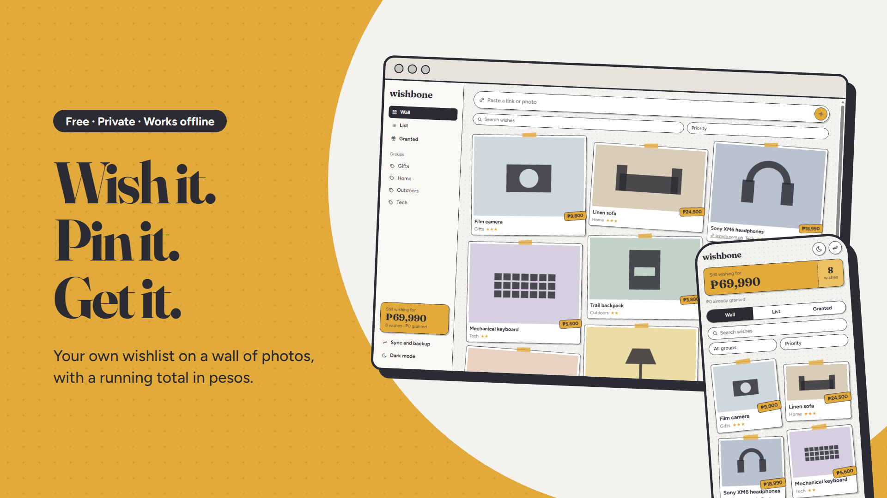

# Wishbone

A private wishlist that lives on a wall of photos, with a running total in pesos.

Pin anything you want to your wall: a photo, a price, a link, and a note. Wishbone adds up what you're still wishing for, keeps what you've already got, and works without internet. Your list stays on your own devices.

## Features

- A wall of tilted photo cards, plus a plain list view and a Granted shelf for things you already got.
- Prices in pesos with a running total of what you're still wishing for, and a separate total for what you've granted.
- Add a wish by typing, pasting a link, or pasting or attaching a photo. Links are saved and clickable.
- Groups, a 3-star priority, notes, search, and sorting by priority, newest, or price.
- Sync your phone and computer on the same Wi-Fi. Your list goes straight from one device to the other, with no account and no server in between.
- Backup file: export your wishes and import them again, or merge them into another device.
- Light mode by default, with a dark mode switch.
- Works offline, and installs to your home screen or desktop like an app.

## Getting started

1. Open Wishbone in your browser at the address where you host it.
2. Tap or click **Install** (in the address bar on a computer, or "Add to Home screen" on a phone) to use it like an app.
3. Paste a link or photo into the bar at the bottom, or press the plus button, to pin your first wish.
4. To sync two devices, open **Sync and backup** on both:
   1. On the first device, choose **Start pairing** and copy the code.
   2. On the second device, choose **Join from the other device**, paste the code, and copy the reply code it gives you.
   3. Paste the reply code on the first device and press **Connect and sync**.
5. If sync can't connect (for example on guest Wi-Fi), use **Export** on one device and **Import** on the other.

## Requirements

- A current version of Chrome, Edge, or Safari.
- For sync: both devices on the same Wi-Fi network, and a network that lets devices talk to each other (guest networks often don't).

## Built with

Plain HTML, CSS, and JavaScript, with no framework. Wishes are stored in the browser, sync uses a direct browser-to-browser connection, and a service worker makes it work offline. See [docs/DEVELOPING.md](docs/DEVELOPING.md) for how to run and host it.

## Status

Active
